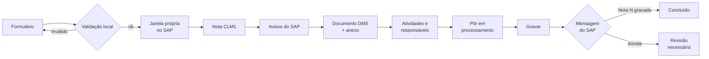
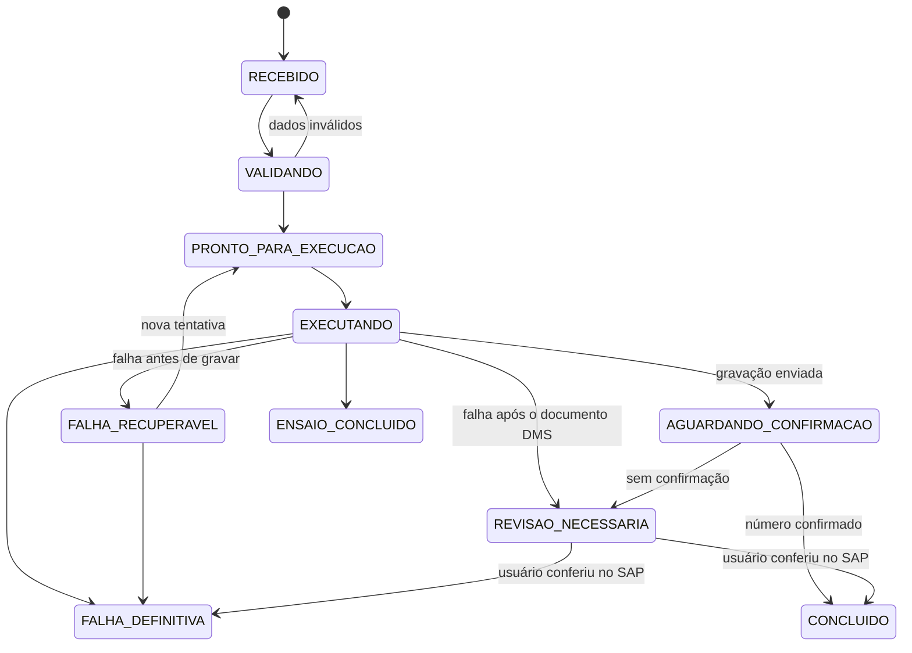
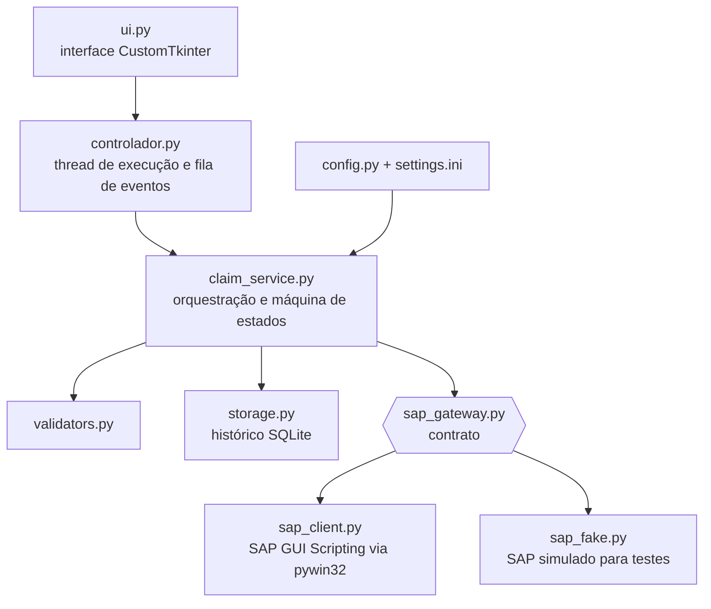
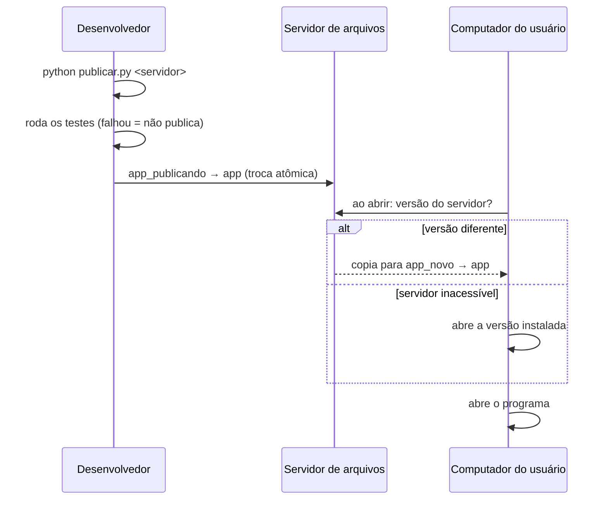

<div align="center">


# Automação de Claims SAP

**Criação automática de claims (reclamações) na transação CLM1 do SAP GUI, do formulário à nota gravada, com anexo, atividades e confirmação.**


</div>

---

## Sumário

- [Visão geral](#visão-geral)
- [Principais recursos](#principais-recursos)
- [Como funciona](#como-funciona)
- [Garantias de segurança](#garantias-de-segurança)
- [Arquitetura](#arquitetura)
- [Requisitos](#requisitos)
- [Instalação para desenvolvimento](#instalação-para-desenvolvimento)
- [Configuração](#configuração)
- [Modos de execução](#modos-de-execução)
- [Distribuição e atualização automática](#distribuição-e-atualização-automática)
- [Testes](#testes)
- [Estrutura do projeto](#estrutura-do-projeto)
- [Limitações conhecidas](#limitações-conhecidas)
- [Autor e licença](#autor-e-licença)

---

## Visão geral

Criar um claim na CLM1 envolve uma sequência longa e repetitiva: preencher a nota, criar um documento DMS, anexar e arquivar o arquivo, escolher atividades numa árvore com dezenas de itens, atribuir responsáveis, pôr a nota em processamento e gravar. Feito à mão, leva vários minutos e é propenso a erros de digitação e de seleção.

Esta aplicação desktop recebe os dados num formulário, **valida tudo antes de tocar no SAP** e executa o processo inteiro sozinha em cerca de 30 segundos, usando **SAP GUI Scripting** (sem coordenadas de tela, sem cliques às cegas). O resultado é confirmado pela resposta do próprio SAP e registrado num histórico local.

> Todos os códigos, usuários, rotas e valores deste repositório são **exemplos fictícios**. A configuração real de cada empresa fica no `settings.ini`.

## Principais recursos

| Recurso | Descrição |
| --- | --- |
| Fluxo completo | Nota, avisos do SAP, documento DMS com anexo e arquivamento, atividades com responsáveis, "pôr em processamento" e gravação |
| Rotas configuráveis | Cada tipo de claim tem sua sequência de atividades e responsáveis, definida só no `settings.ini` |
| Validação local | Campos obrigatórios, formatos, tamanho de arquivo e nome; nada inválido chega ao SAP |
| Janela própria | A automação abre um novo modo na sessão já logada e nunca usa as janelas do usuário |
| Seleção por texto | Itens da árvore são achados pelo nome dentro da pasta, porque os códigos de nó do SAP mudam |
| Conferência da grade | Cada linha criada é conferida (descrição, sub grupo, responsável) antes de transferir |
| Anti-duplicidade | Bloqueia um segundo claim para a mesma ordem/item enquanto houver execução concluída ou pendente |
| Máquina de estados | Depois de enviar a gravação, nenhum caminho volta a gravar automaticamente |
| Interface moderna | CustomTkinter, validação em tempo real, andamento por etapa, histórico e pendências |
| Atualização automática | Publicação num servidor de arquivos; cada computador se atualiza ao abrir |

## Como funciona



Cada etapa aparece na interface em tempo real. Avisos conhecidos do SAP (lista em `[avisos_aceitos]`) são confirmados e registrados; qualquer janela desconhecida interrompe a execução **antes** de gravar.

## Garantias de segurança



- **Nunca grava duas vezes.** Um teste percorre o grafo e prova que, a partir de `AGUARDANDO_CONFIRMACAO`, nenhum caminho volta a `EXECUTANDO`.
- **Sucesso só com evidência:** mensagem do tipo `S` contendo o número da nota.
- **Travas de ambiente:** só age no sistema e mandante configurados; gravação desligada por padrão.
- **Interrupção controlada:** o pedido de parada é atendido entre etapas, nunca no meio de uma gravação.
- **Histórico sem dados sensíveis:** o texto livre e o conteúdo dos anexos não são armazenados.

## Arquitetura



Somente `sap_client.py` conhece IDs técnicos de tela. A lógica de negócio fala com um **contrato** (`SapGateway`) implementado tanto pelo SAP real quanto por um SAP simulado, o que permite testar todo o fluxo, inclusive falhas, sem acesso ao SAP.

## Requisitos

- Windows com **SAP GUI** instalado e **SAP GUI Scripting** habilitado no cliente e no servidor
  (no SAP: Alt+F12 → Opções → Acessibilidade e Scripts → Scripts)
- Python 3 (testado em 3.13 e 3.15)
- `pywin32` e `customtkinter`

## Instalação para desenvolvimento

```powershell
git clone https://github.com/tiagopricilianoo/sap-claim-automation.git
cd sap-claim-automation
python -m pip install -r requirements.txt
python -m pytest -q           # 155 testes, sem precisar de SAP
python ui.py                  # abre no modo Simulação
```

## Configuração

Tudo o que é específico do processo fica em `settings.ini`. Nenhum valor de negócio está no código.

| Seção | O que define |
| --- | --- |
| `[sap]` | Sistema e mandante permitidos (trava de segurança) |
| `[nota]` | Tipo de nota, código de causa e prioridade |
| `[documento]` | Tipo de documento DMS, laboratório e aplicação do original |
| `[limites]` | Tamanhos máximos de descrição, ordem e item |
| `[execucao]` | Modo de execução e habilitação da gravação |
| `[avisos_aceitos]` | Janelas do SAP que podem ser confirmadas (com `*` como curinga) |
| `[atividade.*]` | Cada atividade: texto do item, sub grupo, pasta na árvore e responsável (`@usuario_logado`, fixo ou vazio) |
| `[rota.*]` | Cada tipo de claim e a sequência das suas atividades |

Exemplo de rota:

```ini
[atividade.analise]
descricao = ANALISE TECNICA
subgrupo = GRP-ENG
pasta = 20ENGENHARIA
responsavel =

[rota.PRODUTO_A]
rotulo = Produto A
atividades = analise, com_produto_a
```

Para descobrir os IDs da sua tela, use o gravador de scripts do SAP GUI (Alt+F12 → Gravação e reprodução de script).

## Modos de execução

| Modo | O que faz | Grava no SAP? |
| --- | --- | --- |
| Simulação | Fluxo completo no SAP simulado | Não |
| Ensaio | Nota, atividades e "pôr em processamento" no SAP real | Não |
| Assistido | Tudo, inclusive o documento DMS; para antes de gravar o claim | Só o documento |
| Completo (`AUTOMATICO`) | Tudo, grava e confirma | Sim |

Com `modo = AUTOMATICO` a interface entra em **modo de produção**: sem seletor de modo e com um único botão **Criar claim**. Assistido e Completo só existem com `automatico_habilitado = sim`.

## Distribuição e atualização automática



```powershell
python publicar.py "\\servidor\pasta\AutomacaoClaims" --nota "o que mudou"
```

- Usuários rodam `instalar.bat` **direto da pasta do servidor**, uma única vez; o atalho é criado na área de trabalho.
- O programa roda localmente; o histórico de cada usuário fica em `%LOCALAPPDATA%\ClaimAutomation`.
- A versão anterior fica em `app_anterior`, e cada publicação é registrada em `historico_versoes.txt`.

## Testes

```powershell
python -m pytest -q
```

155 testes cobrem configuração, validação, máquina de estados, histórico, o cliente SAP (com objetos COM simulados que reproduzem o comportamento real da árvore, da grade e das janelas), a orquestração em todos os modos, a interface (controlador) e o ciclo de publicação e atualização. Vários são testes de regressão de problemas encontrados no SAP real, como os códigos de nó que mudam entre sessões.

## Estrutura do projeto

```
sap-claim-automation/
├── ui.py                 Interface desktop
├── controlador.py        Execução em segundo plano e eventos para a tela
├── claim_service.py      Orquestração, modos e regras de estado
├── sap_gateway.py        Contrato com o SAP
├── sap_client.py         SAP GUI Scripting (implementação real)
├── sap_fake.py           SAP simulado
├── config.py             Leitura e validação do settings.ini
├── models.py             Estrutura do claim
├── validators.py         Validações locais
├── state.py              Máquina de estados
├── storage.py            Histórico SQLite
├── logger_config.py      Logs rotativos sem dados sensíveis
├── ensaio.py             Ensaio pelo terminal
├── verificar_sap.py      Diagnóstico somente leitura das sessões
├── publicar.py           Publicação no servidor
├── sobre.py              Autoria
├── settings.ini          Configuração do processo (exemplo)
├── tema.ini              Logo e cor principal
├── assets/               Logo e ícone
├── distribuicao/         Inicializador e instalador
└── tests/                Testes automatizados
```

## Limitações conhecidas

- Depende do SAP GUI para Windows e do SAP GUI Scripting habilitado.
- Os IDs de tela refletem uma configuração específica da CLM1; outras configurações exigem ajustar `sap_client.py` e o `settings.ini`.
- O histórico local é operacional, de um único usuário; não substitui a auditoria do SAP.
- A verificação de duplicidade usa o histórico local; claims criados manualmente no SAP não são vistos.

## Autor e licença

**Elder Tiago Priciliano Ruas**, concepção, arquitetura e desenvolvimento.

© 2026 Elder Tiago Priciliano Ruas. **Todos os direitos reservados.** O código está público apenas para consulta e portfólio. Usar, copiar, modificar ou distribuir, no todo ou em parte, exige autorização prévia e por escrito do autor. Veja [LICENSE](LICENSE) e [NOTICE](NOTICE).

SAP e SAP GUI são marcas registradas da SAP SE. Este projeto não tem vínculo com a SAP SE.
